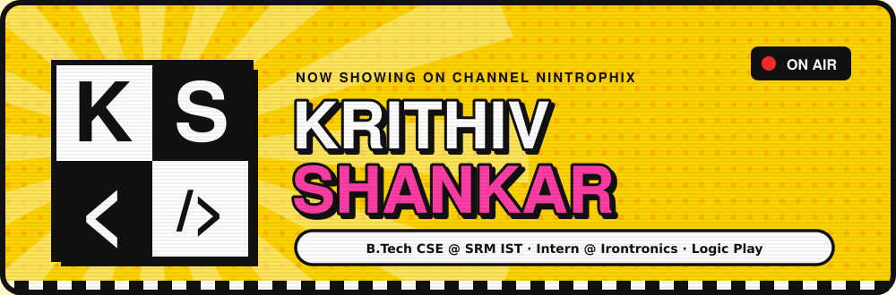
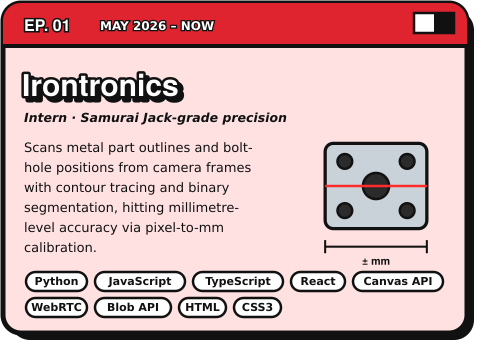
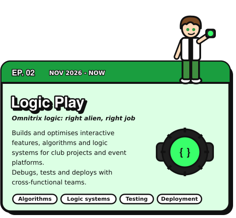
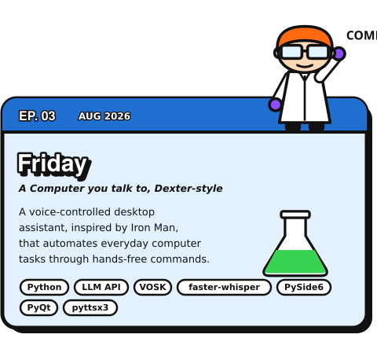
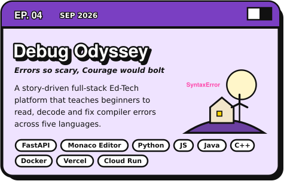
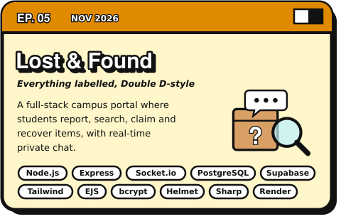
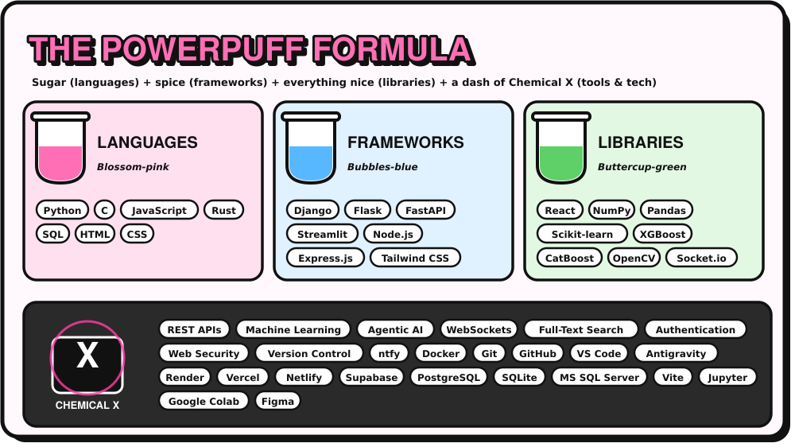
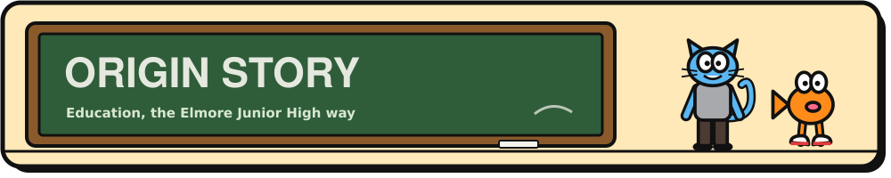

  

### Previously on *Krithiv Shankar*...

A B.Tech CSE student at **SRM IST, Ramapuram** (CGPA **8.88**) who spends the summer as an intern at **Irontronics** teaching a camera to measure metal parts to the millimetre, is a core member at **Logic Play**, and is working through *Machine Learning A-Z* on the side.

 

## Now Airing: Experience

<table>
<tr>
<td width="50%" valign="top"></td>
<td width="50%" valign="top"></td>
</tr>
</table>

## Episode Guide: Projects

<table>
<tr>
<td width="50%" valign="top">

<a href="https://github.com/Nintrophix/Friday"><b>Source</b></a>

</td>
<td width="50%" valign="top">

<a href="https://bug-labs-beta-pink.vercel.app/"><b>Watch live</b></a>

</td>
</tr>
<tr>
<td width="50%" valign="top">

<a href="https://lost-found-hub-4grb.onrender.com/"><b>Watch live</b></a> · <a href="https://github.com/Nintrophix/Lost-Found-Hub"><b>Source</b></a>

</td>
<td width="50%" valign="middle" align="center">
<h3>Coming up next...</h3>

Freelance websites built to order, event posters for official events, and community outreach with <b>Green Global</b>.

Stay tuned.

</td>
</tr>
</table>

  

## Adventure Log: Contributions

  

## Special Episodes: Hackathons

| Event | What went down |
|:--|:--|
| **Celestia 2.0** | **Finalist** with Debug Odyssey, teaching debugging to beginners (Ed-Tech) |
| **Sensora 2.0** | Built **AuthenSight** for intelligent document verification and fraud detection |
| **Adobe University Hackathon 2026** | Took part in the Brand Visibility case-study round |

  

| Where | What | When |
|:--|:--|:--:|
| **SRM IST, Ramapuram** | B.Tech, Computer Science & Engineering · CGPA **8.88/10** | 2024 to present |
| **Chinmaya Vidyalaya** | Class 12 Boards · **82.8%** | 2022 to 2024 |
| **PCFL-KFI Pathashaala** | Class 10 Boards · **88.8%** | 2020 to 2022 |

## Power-ups: Certifications

- **Computer Communications and Networks**, Saylor
- **Machine Learning A-Z: ML, DL, AI with AWS, Python & R**, Kirill Eremenko *(in progress, 2026)*

## Off-Air

- **Freelance web developer**: custom websites for multiple clients
- **Poster designer**: posters and promo creatives for official events across organisations
- **NGO volunteer** with Green Global, on community activities and outreach

 

  

  
  
  

Cartoon Network characters appear as simplified fan art, a non-commercial homage. All rights belong to their owners.

