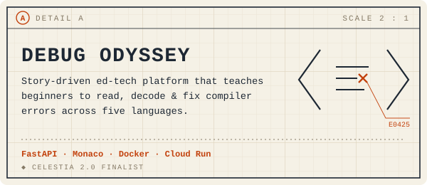
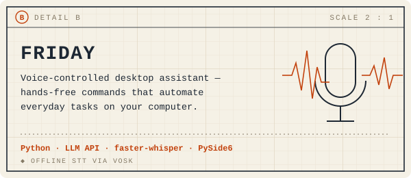
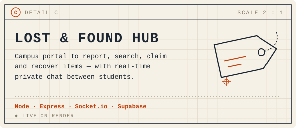
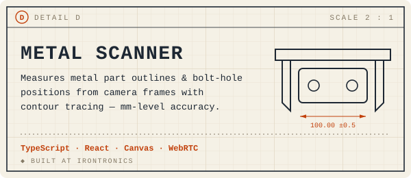
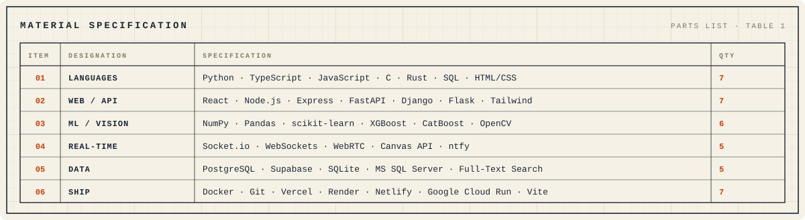

<picture>
  <source media="(prefers-color-scheme: dark)" srcset="assets/header-dark.svg">
  
</picture>

```text
GENERAL NOTES — UNLESS OTHERWISE SPECIFIED
```

1. **Currently** a summer intern at **Irontronics**, writing computer vision that measures metal parts from a camera feed to the millimetre.
2. **Core member** at **Logic Play**: I build the logic systems and interactive features behind club projects and event platforms.
3. **Studying** B.Tech CSE at SRM IST, Ramapuram (CGPA 8.88) and working through *Machine Learning A–Z*.
4. **Outside the editor:** freelance websites, event posters, and volunteering with Green Global.
5. **All bugs are to be deburred before shipping.** Tolerance is ±0 bugs\*.

<sub>\* aspirational.</sub>

<br>

<table>
<tr>
<td width="50%">
<a href="https://bug-labs-beta-pink.vercel.app/"><picture>
  <source media="(prefers-color-scheme: dark)" srcset="assets/detail-debug-dark.svg">
  
</picture></a>
<p align="center"><a href="https://bug-labs-beta-pink.vercel.app/">live</a> · <a href="https://github.com/Nintrophix/Debug-Odyssey">source</a></p>
</td>
<td width="50%">
<a href="https://github.com/Nintrophix/Friday"><picture>
  <source media="(prefers-color-scheme: dark)" srcset="assets/detail-friday-dark.svg">
  
</picture></a>
<p align="center"><a href="https://github.com/Nintrophix/Friday">source</a></p>
</td>
</tr>
<tr>
<td width="50%">
<a href="https://lost-found-hub-4grb.onrender.com/"><picture>
  <source media="(prefers-color-scheme: dark)" srcset="assets/detail-lost-dark.svg">
  
</picture></a>
<p align="center"><a href="https://lost-found-hub-4grb.onrender.com/">live</a> · <a href="https://github.com/Nintrophix/Lost-Found-Hub">source</a></p>
</td>
<td width="50%">
<a href="https://github.com/Nintrophix/Metal-Scanner"><picture>
  <source media="(prefers-color-scheme: dark)" srcset="assets/detail-metal-dark.svg">
  
</picture></a>
<p align="center"><a href="https://github.com/Nintrophix/Metal-Scanner">source</a></p>
</td>
</tr>
</table>

<picture>
  <source media="(prefers-color-scheme: dark)" srcset="assets/spec-dark.svg">
  
</picture>

### Revision history

| Rev | Date | Description |
|:---:|:-----|:------------|
| **F** | Nov 2026 | Joined **Logic Play** as a core member. Shipped **Lost & Found Hub**. |
| **E** | Sep 2026 | Released **Debug Odyssey**. Finalist at **Celestia 2.0**. |
| **D** | Aug 2026 | Built **Friday**, a voice assistant for my own desktop. |
| **C** | May 2026 | Started as an intern at **Irontronics**, working on vision-based metrology. |
| **B** | 2026 | Took part in **Sensora 2.0** (AuthenSight, document fraud detection) and the **Adobe University Hackathon**. |
| **A** | Aug 2024 | Started B.Tech CSE at **SRM IST**. |

<br>

<p align="center">
  <a href="https://krithivshankar.vercel.app/"><b>portfolio</b></a> &nbsp;·&nbsp;
  <a href="https://www.linkedin.com/in/krithiv-shankar"><b>linkedin</b></a> &nbsp;·&nbsp;
  <a href="mailto:krithiv.shankar@gmail.com"><b>email</b></a>
  <br>
  <sub>DWG NO. NTX-001 · SHEET 1 OF 1 · DO NOT SCALE DRAWING</sub>
</p>
